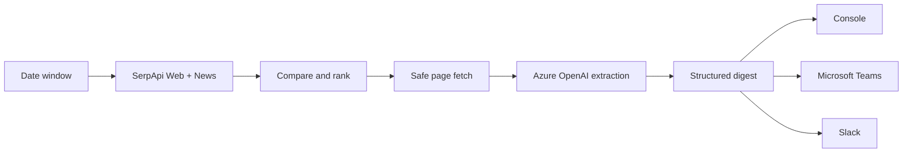
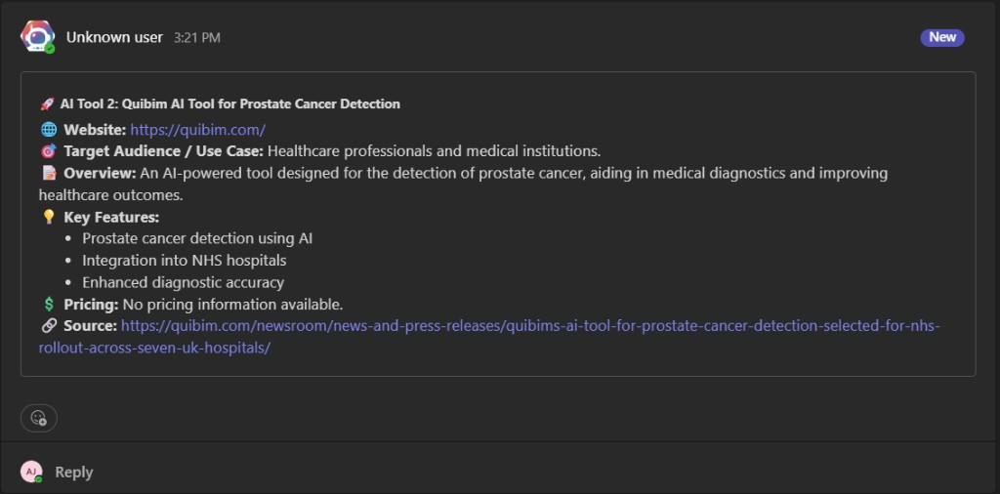
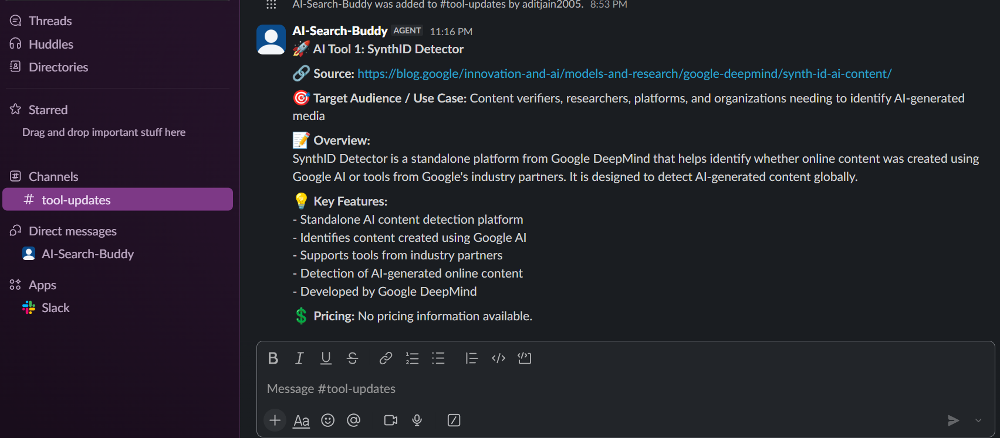

# AI Tool Discovery Agent

> **SerpApi India Hackathon 2026 · Track 01 — AI Agents**

## Discover what shipped. Not what ranked.

The AI Tool Discovery Agent turns a noisy, fast-moving web into a concise weekly intelligence brief for product, research, and operations teams.

It plans a date window, searches Google Web and Google News through SerpApi, compares and de-duplicates the evidence, follows relevant product pages, extracts a structured tool record with Azure OpenAI, and delivers the result to the console, Microsoft Teams, or Slack.

**Search is the source of truth.** The agent never invents launches. Every item in the digest originates in a compared SerpApi result and is backed by a fetched source page.

| | |
|---|---|
| **Live experience** | [serpapi-track1.vercel.app](https://serpapi-track1.vercel.app/) |
| **Command guide** | [serpapi-track1.vercel.app/guide](https://serpapi-track1.vercel.app/guide) |
| **Repository** | [github.com/Adit-Jain-srm/SerpApi_Track1](https://github.com/Adit-Jain-srm/SerpApi_Track1) |

## Why it matters

AI launches are abundant; reliable discovery is not. Search results mix product pages, launch articles, listicles, aggregators, and stale coverage. Teams need a short list of named products they can act on—not another ranking page to investigate.

This agent makes the rejection step the product:

- **Freshness:** Web and news searches are constrained to the requested date window.
- **Evidence:** Candidates are compared before any page is fetched or summarized.
- **Signal:** Roundups, aggregators, duplicates, and irrelevant pages are removed.
- **Structure:** Each accepted product becomes a predictable record: title, website, audience, overview, features, pricing, and source.
- **Action:** Results are printed locally and can be delivered directly to the channels where teams work.

## How it works



### 1. Plan

`--days` defines the discovery window and defaults to seven days. Google Web uses SerpApi's `tbs=qdr:dN`; Google News uses an `after:YYYY-MM-DD` cutoff based on UTC.

### 2. Search

The agent runs launch-oriented queries across web and news, plus homepage-oriented web queries. Search execution is bounded and resilient: if one engine fails, the other can still produce candidates; if both fail, the run exits clearly instead of reporting a false success.

### 3. Compare

Before fetching anything, candidates are normalized, merged, ranked, and filtered:

- duplicate URLs collapse into one candidate;
- aggregator domains and listicle-style titles are removed;
- product homepages are preferred over commentary pages;
- news dates take precedence when sources disagree;
- `--max-urls` controls the extraction budget.

### 4. Extract and deliver

Compared pages are fetched over HTTPS with bounded responses and redirect validation. Azure OpenAI converts the selected product pages into structured `ToolInfo` records. One failed candidate does not discard successful candidates. The digest is then printed and optionally delivered to Teams, Slack, or configured subscribers.

## Quick start

### Requirements

- Python 3.10+
- A [SerpApi API key](https://serpapi.com/manage-api-key)
- An Azure OpenAI endpoint, key, and deployment
- Optional: Teams webhook, Slack bot credentials, or subscriber delivery configuration

### Windows PowerShell

```powershell
git clone https://github.com/Adit-Jain-srm/SerpApi_Track1.git
cd SerpApi_Track1
python -m venv .venv
.\.venv\Scripts\Activate.ps1
python -m pip install -r requirements.txt
Copy-Item .env.example .env
```

### macOS / Linux

```bash
git clone https://github.com/Adit-Jain-srm/SerpApi_Track1.git
cd SerpApi_Track1
python3 -m venv .venv
source .venv/bin/activate
python -m pip install -r requirements.txt
cp .env.example .env
```

Configure the required values in `.env`:

```dotenv
SERPAPI_API_KEY=
AZURE_OPENAI_ENDPOINT=
AZURE_OPENAI_KEY=
AZURE_OPENAI_DEPLOYMENT=gpt-5.3-chat
```

See [docs/KEYS.md](docs/KEYS.md) for Teams, Slack, Supabase, and deployment configuration. Never commit `.env`.

## Run it

```bash
# Compare recent search results without fetching pages or using Azure
python main.py --dry-run --days 7

# Run a small end-to-end digest locally
python main.py --days 7 --max-urls 3 --skip-teams --skip-slack

# Run with the default seven-day window
python main.py
```

| Option | Purpose |
|---|---|
| `--days N` | Search the last `N` days. |
| `--max-urls N` | Limit candidates sent to fetch and extraction. |
| `--dry-run` | Search and compare only; no page fetch, Azure call, or delivery. |
| `--skip-teams` | Disable Teams delivery for the run. |
| `--skip-slack` | Disable Slack delivery for the run. |

## Deployment model

The public Next.js site is deployed on Vercel and provides the product experience, live diagnostics, proof routes, and run guidance. Vercel does **not** spawn the Python discovery worker.

The production worker runs through:

- **GitHub Actions:** scheduled weekly execution;
- **Repository CLI:** manual execution from a configured machine.

This separation keeps long-running search, crawling, extraction, and delivery work in a durable worker environment while the web application remains fast and transparent.

## Quality and safety

The project includes:

- hermetic Python tests with external services mocked;
- CI checks for Python tests, TypeScript, ESLint, and the production build;
- SSRF-aware URL validation for crawler and webhook egress;
- redirect revalidation and bounded response sizes;
- per-candidate extraction failure isolation;
- deterministic candidate ordering and deduplication;
- explicit partial-run and unavailable-runtime states;
- secret-safe diagnostics and delivery reporting.

Run the test suite locally:

```bash
python -m pytest tests -q
```

Run the web checks:

```bash
cd web
npm ci
npm run typecheck
npm run lint
npm run build
```

## Delivery preview

The digest is intentionally compact and channel-friendly:



*Illustrative Teams output showing the structured digest shape.*



*Illustrative Slack output using the same structured fields.*

## Project structure

```text
SerpApi_Track1/
├── main.py                 # CLI entry point
├── agents/
│   ├── search_agent.py     # SerpApi web/news search
│   ├── pipeline_agent.py   # orchestration and resilience
│   └── scraper_agent.py    # safe fetch and Azure extraction
├── config/                 # defaults and query configuration
├── models/                 # structured ToolInfo model
├── output/                 # console, Teams, Slack, subscribers
├── prompts/                # extraction prompts
├── utils/                  # URL safety and shared helpers
├── tests/                  # hermetic regression suite
├── web/                    # Next.js product experience
├── docs/                   # keys, MCP, and hackathon notes
└── .github/workflows/      # CI and weekly worker schedule
```

## Hackathon submission

This project was built for the [SerpApi India Hackathon 2026](docs/HACKATHON.md), Track 01: AI Agents.

- [Hackathon judging map](docs/HACKATHON.md)
- [Environment and secrets](docs/KEYS.md)
- [MCP usage](docs/MCP.md)

## Author

**Adit Jain**
[github.com/Adit-Jain-srm](https://github.com/Adit-Jain-srm)
