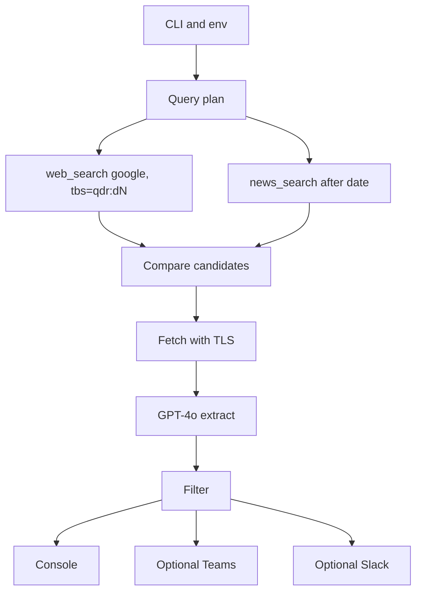
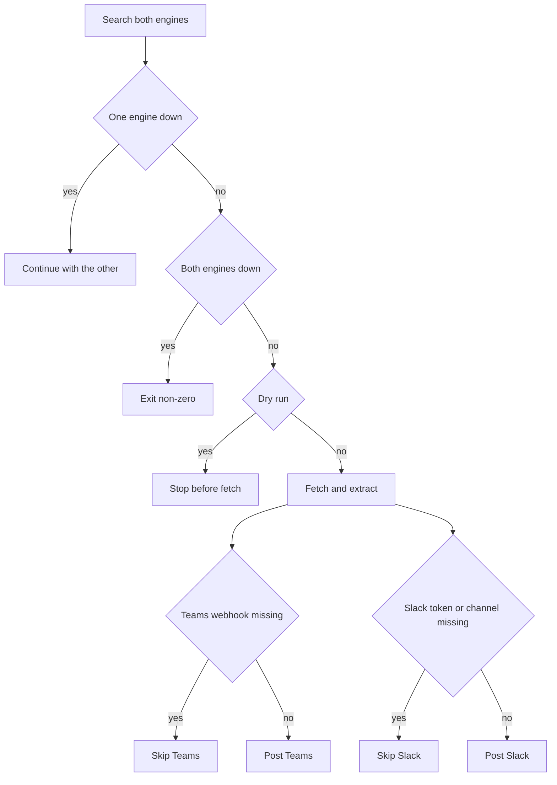

# AI Tool Discovery Agent

A weekly digest of newly launched AI tools for a team that cannot watch the open web. It plans a date window, searches SerpApi web and news, compares the hits, and delivers a short structured list in the console, in Microsoft Teams, or in Slack.

**Adit Jain**

The project existed before this hackathon. An earlier version searched with Serper and a raw SerpApi client. This repository is the Track 01 submission. Search uses SerpApi only, through [`serpapi-search-tools`](https://serpapi.github.io/serpapi-search-tools-python/). Serper is not part of this pipeline. The submitted SerpApi web-and-news path, CLI, tests, Slack output, and public site are part of this submission.

Clone URL: `https://github.com/Adit-Jain-srm/SerpApi_Track1`

Live site: [https://serpapi-track1.vercel.app](https://serpapi-track1.vercel.app). The install and command guide is [https://serpapi-track1.vercel.app/guide](https://serpapi-track1.vercel.app/guide).

## Who it is for

Product, research, and operations people who need the launches from a recent window, with aggregator and news noise already removed. The output is a handful of named tools, each with a source page, a short overview, and optional delivery to a Teams or Slack channel.

SerpApi web and news results are required. Every tool in the digest is a compared search hit that was fetched and extracted.

## Pipeline





1. **Plan.** `--days` sets the window (default 7). When the flag is omitted, `SEARCH_DAYS` overrides that default. Web search is pinned to `google` with `tbs=qdr:d{N}` (`tbs=qdr:d7` for seven days). Web queries do not get an `after:` suffix. News search uses `google_news` and puts `after:YYYY-MM-DD` in the query, from the UTC start of the window. News does not receive `tbs`.
2. **Search.** Four launch-intent queries — new tool, new app, now available, open-source launch — run through `web_search` and `news_search`. That is eight searches per run, sized for the free monthly credit pool. Web links come from `organic_results[].link`. News links come from `news_results[].link`. If one engine fails, the run continues with the other. If both fail, the process exits non-zero.
3. **Compare.** Each candidate keeps its URL, title, snippet, published time, and which engines produced it. URLs are normalized, aggregator domains are dropped, and duplicates merge. When web and news disagree on the date, the news date is kept. `--max-urls` caps how many candidates continue.
4. **Act.** Pages are fetched over TLS and Azure OpenAI extracts a structured tool record. The deployment name is `AZURE_OPENAI_DEPLOYMENT`. When that variable is empty the client defaults to `gpt-4o`. The call sends `max_completion_tokens` and temperature `1`, which this chat API accepts. The console prints the summary. Teams receives a message when `TEAMS_WEBHOOK_URL` is set and `--skip-teams` was not passed. Slack receives a message when `SLACK_BOT_TOKEN` and `SLACK_CHANNEL_ID` are set and `--skip-slack` was not passed. `--dry-run` prints the comparison table and stops before fetch. It does not call Azure or post to Teams or Slack. A sample of the Teams shape is `assets/teams_output_example.png`.

Key setup, the interactive MCP client, and the hackathon notes:

- [docs/KEYS.md](docs/KEYS.md)
- [docs/MCP.md](docs/MCP.md)
- [docs/HACKATHON.md](docs/HACKATHON.md)

## Setup

Python 3.10 or higher. A SerpApi key and an Azure OpenAI endpoint, key, and deployment name. Teams and Slack are optional.

### Windows (PowerShell)

```powershell
git clone https://github.com/Adit-Jain-srm/SerpApi_Track1.git
cd SerpApi_Track1
python -m venv .venv
.\.venv\Scripts\Activate.ps1
python -m pip install -r requirements.txt
Copy-Item .env.example .env
```

If script activation is blocked, use cmd instead: `.venv\Scripts\activate.bat`.

### Windows (cmd)

```bat
git clone https://github.com/Adit-Jain-srm/SerpApi_Track1.git
cd SerpApi_Track1
python -m venv .venv
.venv\Scripts\activate.bat
python -m pip install -r requirements.txt
copy .env.example .env
```

### Unix

```bash
git clone https://github.com/Adit-Jain-srm/SerpApi_Track1.git
cd SerpApi_Track1
python3 -m venv .venv
source .venv/bin/activate
python -m pip install -r requirements.txt
cp .env.example .env
```

Fill in `.env` from [.env.example](.env.example). Required names are `SERPAPI_API_KEY`, `AZURE_OPENAI_ENDPOINT`, and `AZURE_OPENAI_KEY`. `AZURE_OPENAI_DEPLOYMENT` selects the deployment and defaults to `gpt-4o` when empty. Optional names are `TEAMS_WEBHOOK_URL`, `SLACK_BOT_TOKEN`, `SLACK_CHANNEL_ID`, `SLACK_APP_TOKEN`, `BATCH_SIZE`, `LLM_CONCURRENCY_LIMIT`, and `SEARCH_DAYS`. Slack sits beside Teams. Posting needs the bot token and the channel ID for the **AI-Search-Buddy** app. `SLACK_APP_TOKEN` is stored for a future socket-mode listener and is not used to post. Leave the bot token or channel ID empty to skip Slack. Invite the bot to the channel, then paste the channel ID (not the channel name). `--skip-slack` skips Slack even when both are set, and `--dry-run` does not post to Slack or Teams. Do not commit `.env`. Serper is not a variable in this project.

The public site, when deployed, uses Vercel project root `web/` and one variable, `SERPAPI_API_KEY`. Azure, Teams, and Slack stay off Vercel. Details are in [docs/KEYS.md](docs/KEYS.md).

## Run

From the repo root, with the virtual environment active:

```bash
python main.py
python main.py --days 7
python main.py --dry-run
python main.py --skip-teams
python main.py --skip-slack
python main.py --days 7 --max-urls 3
```

| Flag | Behavior |
|---|---|
| `--days` | Date window in days. Default 7, or `SEARCH_DAYS` when the flag is omitted. Must be a positive integer. |
| `--dry-run` | Print the comparison table. Do not fetch, call Azure, or post to Teams or Slack. |
| `--skip-teams` | Skip the webhook. Still print the console summary. |
| `--skip-slack` | Skip Slack even when the bot token and channel ID are set. Still print the console summary. |
| `--max-urls` | Cap how many compared candidates are fetched and extracted. Must be a positive integer. |

`--dry-run` needs `SERPAPI_API_KEY`. It does not need the Azure variables, and it does not call Azure.

### Edge cases

| Input | What happens |
|---|---|
| `--days 0` or any negative `--days` | Exit code 2. stderr says `--days must be a positive integer`. No traceback, no search, no fetch, no Teams, no Slack. |
| `--max-urls 0` or any negative `--max-urls` | Exit code 2. stderr says `--max-urls must be a positive integer`. The run does not print an empty table. |
| One of web or news fails | The run logs the error and continues with the engine that succeeded. |
| Web and news both fail | Exit code 1. stderr says both searches failed. |
| `--dry-run` | Search and the comparison table only. Stops before fetch. |
| `TEAMS_WEBHOOK_URL` empty, or `--skip-teams` | Console summary only. Teams is skipped. |
| Slack token or channel empty, or `--skip-slack` | Slack is skipped. The rest of the run continues. |

On Windows the process sets stdout and stderr to UTF-8, replacing characters the console cannot store, so a snippet outside cp1252 does not abort the table.

## Tests

From the repo root, with the virtual environment active:

```bash
python -m pytest tests -q
```

The suite stays offline: a fake search client stands in for SerpApi, and the tests do not call Azure, Teams, or Slack. They cover the date plan, candidate merge, recency, dry-run, invalid `--days` and `--max-urls`, Windows console text, the Azure chat parameter names, and Teams and Slack formatting.

## Sample Teams message

This is the shape of one webhook message, filled with sample fields so the layout is readable. It is a format example.

When the website and the source URL are the same, the website line is omitted.

```text
### 🚀 AI Tool 1: Northstar

**🌐 Website:** [https://northstar.example](https://northstar.example)

**🔗 Source:** [https://northstar.example/blog/launch](https://northstar.example/blog/launch)

**🎯 Target Audience / Use Case:** Developers shipping internal agents

**📝 Overview:**
Northstar drafts weekly research briefs from a fixed set of sources.

**💡 Key Features:**
- Watches a date window for new launches
- Writes a short structured summary

**💰 Pricing:** No pricing information available.
```

## Layout

```text
SerpApi_Track1/
├── main.py                 # CLI and console, Teams, or Slack output
├── agents/
│   ├── config_agent.py     # environment and required keys
│   ├── pipeline_agent.py   # orchestration
│   ├── search_agent.py     # web_search and news_search
│   └── scraper_agent.py    # page fetch and Azure extraction
├── config/constants.py     # defaults, aggregator domains, queries
├── models/tool_info.py
├── output/                 # console, Teams, and Slack
├── prompts/
├── utils/
├── docs/                   # KEYS.md, MCP.md, HACKATHON.md
├── .env.example
├── requirements.txt
└── README.md
```

`data/blacklist.json` is created at runtime and is not committed.

## Author

**Adit Jain**

Repository: https://github.com/Adit-Jain-srm/SerpApi_Track1
