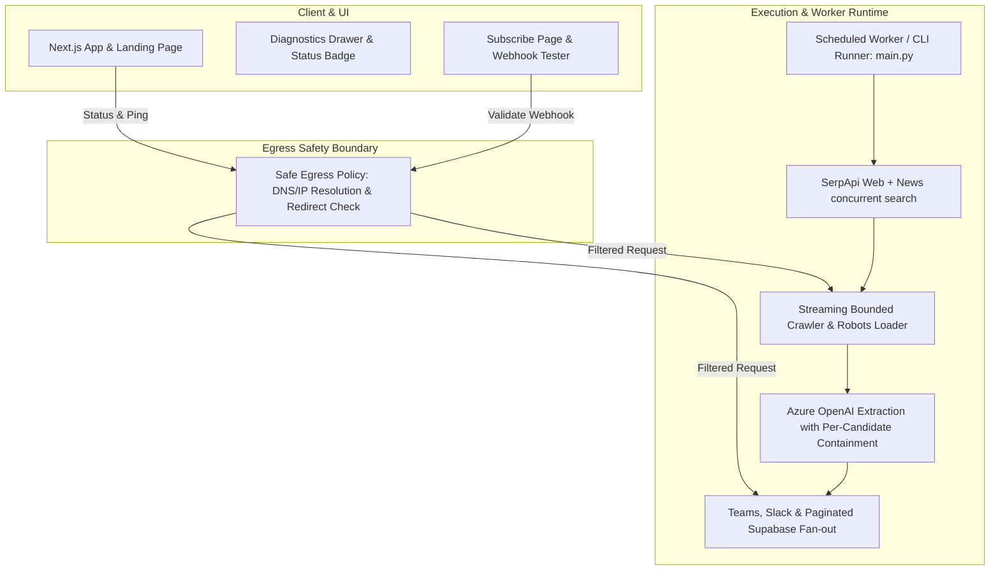

# 🏛️ Architecture & Product Remediation Plan
**Project:** AI Tool Discovery Agent (SerpApi Indian Hackathon 2026, Track 01)  
**Date:** 11 October 2026  
**Status:** Plan Approved for Execution  
**Standards:** Staff Engineer Approval Bar (`@verification-and-elegance`, `@elite-execution-philosophy`, `@ui-ux-pro-max`)

---

## Executive Summary & Root Cause Analysis

The architecture review of 11 October 2026 accurately identified that the system's core algorithmic discovery flow (Search $\to$ Comparison $\to$ Article Resolution $\to$ Extraction $\to$ Digest Delivery) is architecturally sound, but suffers from critical friction and exposure **at the system seams**:
1. **Unconstrained Egress (SSRF)**: Arbitrary HTTPS URLs from search results and user inputs are fetched without validating private/internal IP boundaries.
2. **Fragile Pipeline Error Handling**: A single LLM failure in `asyncio.as_completed` drops all successful candidates, and wrapped exceptions bypass rate-limit retries.
3. **Product-Runtime Asymmetry**: Hosted Vercel functions cannot invoke local Python subprocesses without clear communication; subscription copy promises automated weekly digests without an automated scheduler.
4. **Diagnostic Integrity**: Masthead status and Azure telemetry in the UI had hardcoded elements rather than reporting measured live state.
5. **Instruction Pollution**: An always-applied OSS bounty rule diverted coding assistants from the repository's actual mission.

Below is the concrete, prioritized remediation strategy to address all findings.

---

## System Seam Architecture Map

---

## Detailed Remediation Phases

### Phase 1: Security & Unified Egress Boundary (P1)
**Goal:** Prevent Server-Side Request Forgery (SSRF) and credential leakage across all external network calls.

| Issue | Root Cause | Solution | Files |
|---|---|---|---|
| **Crawler & Robots SSRF** | `fetch_with_retries` and `is_allowed_by_robots` only check for `https://` prefix; private/loopback IPs are reachable. | Create `utils/url_safety.py`. Resolve hostname to IP before socket connect; reject loopback (`127.0.0.0/8`), RFC1918 (`10.0.0.0/8`, `172.16.0.0/12`, `192.168.0.0/16`), link-local (`169.254.0.0/16`), IPv6 loopback (`::1`), and cloud metadata services. Re-validate every redirect hop. | [scraper_agent.py](file:///c:/Users/aditj/New%20Projects/SerpApi_Track1/agents/scraper_agent.py), [prompt_loader.py](file:///c:/Users/aditj/New%20Projects/SerpApi_Track1/utils/prompt_loader.py) |
| **Diagnostics SSRF Proxy** | `POST /api/diagnostics` makes unauthenticated server-side requests to arbitrary URLs. | Create `web/lib/url-safety.ts`. Validate destination IP, enforce 5s timeout, restrict destinations to verified webhook patterns or origin-checked callers, cap response excerpt. | [route.ts](file:///c:/Users/aditj/New%20Projects/SerpApi_Track1/web/app/api/diagnostics/route.ts) |
| **Subscriber Webhook Targets** | Subscribed URLs only verified by regex `^https://`; worker uses `requests.post` following redirects. | Validate URLs at save time and send time through safe egress checker; disable automatic redirect following or validate each hop. | [subscribers.py](file:///c:/Users/aditj/New%20Projects/SerpApi_Track1/output/subscribers.py), [actions.ts](file:///c:/Users/aditj/New%20Projects/SerpApi_Track1/web/app/subscribe/actions.ts) |
| **SerpApi Key in Exceptions** | Diagnostic error handling could expose query parameters containing `api_key`. | Strip query params and redact API keys before returning exception details or writing to logs. | `web/app/api/diagnostics/route.ts` |
| **Unrelated Mission Rule** | `.agents/rules/agent-core.mdc` instructs agent to seek OSS bounties and maximize GitHub commits. | Replace with clean repo-specific instructions dedicated to AI Tool Discovery Agent architecture. | [.agents/rules/agent-core.mdc](file:///c:/Users/aditj/New%20Projects/SerpApi_Track1/.agents/rules/agent-core.mdc), [.cursor/rules/agent-core.mdc](file:///c:/Users/aditj/New%20Projects/SerpApi_Track1/.cursor/rules/agent-core.mdc) |

---

### Phase 2: Pipeline Reliability & Failure Isolation (P1/P2)
**Goal:** Ensure the pipeline is resilient, deterministic, cost-controlled, and observable.

| Component | Issue | Architecture Fix |
|---|---|---|
| **Rate Limit Retries** | `extract_tool_info_with_llm` catches all exceptions and wraps in `ExtractionError`, preventing `_extract_with_retry` from detecting `RateLimitError`. | Unpack or preserve `RateLimitError` across the boundary so throttled retries with exponential backoff and jitter execute. |
| **Candidate Extraction Isolation** | `asyncio.as_completed` awaits tasks directly without try/except; one model failure terminates the entire run. | Wrap candidate extraction so failure on candidate $k$ logs a clear diagnostic and returns `None` or a failed state, while remaining candidates complete. |
| **Streaming Byte Cap** | `resp.text()` buffers entire HTML before prompt character truncation. | Stream response chunks with an explicit decompressed limit (e.g. 500 KB) and abort oversized payloads. |
| **Untrusted Content Defense** | Prompt mixes raw HTML with system instructions without clear isolation. | Wrap page HTML inside untrusted content delimiters (`<<<PAGE_CONTENT>>>`) with explicit system instructions to ignore prompt injection. |
| **Date & Recency Handling** | TypeError on naive vs aware ISO timestamps; invalid dates pass by default. | Normalize timestamps to UTC; explicitly record `is_recent: bool | None` and avoid labeling unknown dates as verified launches. |
| **Search Concurrency** | Serial queries across 6 web and 4 news endpoints. | Run query groups with bounded async concurrency (`asyncio.gather` with semaphore) preserving SerpApi rate limits. |
| **Deterministic Ordering** | Candidates appended in completion order, altering lead selection. | Sort extracted results by original search ranking before lead pruning and budgeting. |
| **Default Candidate Budget** | `max_urls` defaults to `None`. | Set safe documented default (10 candidates) in `config_agent.py` to prevent runaway LLM costs. |

---

### Phase 3: Runtime Truth & Delivery Integrity (P1/P2)
**Goal:** Match product promises to deployed reality and guarantee delivery observability.

1. **Automated Weekly Scheduler**:
   - Create `.github/workflows/weekly-digest.yml`: Scheduled GitHub Actions cron (`0 9 * * 1` = Mondays at 09:00 UTC) with secrets configured to run `python main.py`.
   - Update landing page & subscribe copy to clearly state: *"Automated weekly run via scheduled GitHub Actions worker; manual runs via CLI or local console."*
2. **Hosted Run Route Transparency**:
   - In `web/app/api/run/route.ts`: Detect environment. If local Python is missing, return a structured payload explaining the execution model with instructions for local operation.
3. **Subscriber Fan-out & Pagination**:
   - In `output/subscribers.py`: Paginate Supabase REST queries using `Range: 0-999`, `Range: 1000-1999` to support unbounded subscribers.
   - Run webhook dispatches with bounded async concurrency (`aiohttp` with connection pooling) and log per-channel delivery summaries (`X succeeded, Y failed`).
4. **Structured CLI Exit Policy**:
   - Return detailed channel status; exit with non-zero code only if required deliveries fail according to configured flags.

---

### Phase 4: Truthful Diagnostics, UI/UX & Accessibility (P2/P3)
**Goal:** Deliver an elite, honest, and accessible frontend experience.

1. **Truthful Diagnostics Binding**:
   - Masthead indicator dynamically reads actual diagnostic API state (`operational`, `degraded`, `checking`) rather than hardcoding green.
   - `DiagnosticsDrawer`: Bind Azure card to real live check results and display exact timestamp of the probe.
2. **Parity Between Doctor and Runtime**:
   - In the web diagnostics route: Use the same Azure API version as extraction, validate Teams URL reachability or label it as "format syntax only", and distinguish Supabase service role vs anon key access.
3. **Sample vs Live Proof Clarification**:
   - Label cards on the landing page as *"Sample Digest Card — Illustrative"* while maintaining `/api/proof` for live preview verification.
4. **Accessibility & WebGL Optimization**:
   - In `DiagnosticsDrawer`: Implement focus trapping, background `inert`, and escape key listener.
   - In `RunDrawer`: Implement `aria-live="polite"` region for terminal state announcements.
   - In `PaperPress`: Lazy load Three.js, pause render loop when off-screen using `IntersectionObserver`, and disable immediately on `prefers-reduced-motion`.

---

### Phase 5: Hermetic Quality Gate & CI (P2/P3)
**Goal:** Eliminate test network leaks and ensure automated quality gates on every commit.

1. **Hermetic Test Isolation**:
   - Update `tests/conftest.py` and pipeline tests: Mock all requests and database calls so `pytest` never hits live Supabase or external endpoints during unit tests.
2. **Continuous Integration Workflow**:
   - Create `.github/workflows/ci.yml`:
     - Python step: `pytest -v --cov`
     - Web step: `npm run lint`, `npm run typecheck`, `npm run build`
   - Add `"typecheck": "tsc --noEmit"` to `web/package.json`.

---

## Verification Matrix

| Area | Verification Command | Success Standard |
|---|---|---|
| Safe Egress & SSRF | Unit tests against private IPs (`127.0.0.1`, `169.254.169.254`, `10.0.0.1`) | Blocked with `SecurityError` |
| Pipeline Resilience | Mock test simulating 1 LLM failure among 5 candidates | 4 tools successfully extracted, 1 flagged; exit 0 |
| Rate-Limit Retry | Mock test raising `RateLimitError` | Retries 3 times with backoff, then succeeds |
| Diagnostics Parity | `GET /api/diagnostics` | Truthful statuses, no exposed keys |
| Test Hermeticity | `python -m pytest` with disconnected network / unconfigured env | 100% pass without network requests |
| Production Build | `npm run build` and `npm run typecheck` | 0 errors, 0 warnings, valid bundle |
